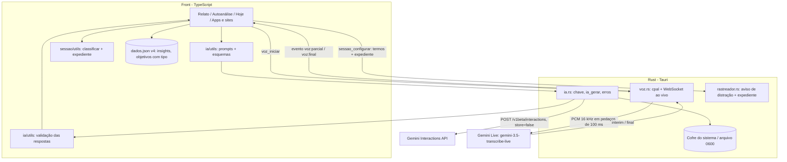

# IA com Gemini Design

**Spec**: `.specs/features/ia-gemini/spec.md`
**Context**: `.specs/features/ia-gemini/context.md`
**Status**: Approved (2026-10-17)

---

## Architecture Overview

Abordagem A, escolhida na discussão: **o Rust é a porta única para o Gemini**. O front monta os pedidos (prompt, dados do dia e esquema JSON) e valida as respostas em TypeScript, onde já estão a classificação e os dados, e onde o Vitest testa tudo. O Rust guarda a chave no cofre do sistema, põe o modelo e a chave em cada chamada, faz o REST (Interactions API) e o WebSocket da transcrição ao vivo, e manda o texto parcial ao front por eventos. A chave nunca entra no webview, e a CSP não muda.

A classificação ganha o tipo `trabalho` e o horário de trabalho da Rotina, sem IA. A IA só sugere por cima disso.



**Fluxos:**

1. **Insight do dia:** relato final → `montarPedidoDoDia(dados, dia, ajustes)` → `ia_gerar` → texto JSON → `lerRespostaDoDia` → salva o `InsightDia` → os grupos mostram as sugestões → a pessoa aceita → `ajustes` do relato → salvar o relato (caminho atual do banco).
2. **Plano:** salvar o plano → `montarPedidoDoPlano` → `ia_gerar` → `lerRespostaDoPlano` (dedup, matéria inexistente vira título) → `objetivos/salvar`. Em falha, cai no `sugerirObjetivos` atual.
3. **Voz:** "Falar" → `voz_iniciar(vocabulário)` → o Rust captura, converte e envia; os eventos `voz:parcial` vão preenchendo o campo → "Parar" → `voz_parar` devolve o texto final.
4. **Insight da semana:** Autoanálise → `montarPedidoDaSemana` → `ia_gerar` → `lerRespostaDaSemana` → salva o `InsightSemana`.

---

## Code Reuse Analysis

### Existing Components to Leverage

| Component | Location | How to Use |
| --------- | -------- | ---------- |
| Captura do microfone (cpal) e `reamostrar` | `src-tauri/src/voz.rs` (`imp::Gravacao`, `reamostrar`) | Manter a captura; trocar o acúmulo em memória por envio em pedaços de 100 ms |
| `classificar`, `porTermos`, `termosDoObjetivo` | `src/features/sessao/utils/classificacao.ts` | Estender: objetivo de trabalho antes, expediente depois das regras |
| `resumir`, `Grupo`, `totaisDaSessao`, `ajustesMudados` | `src/features/sessao/utils/resumo.ts` | Base dos grupos que vão para o prompt; ganha `trabalhoMs` |
| `recalcularDia` | `src/features/hoje/utils/dia.ts:118` | Recalcular sessões quando o horário de trabalho muda (EXPED-07) |
| `configuracaoDoRastreio`, `termosDoDia` | `src/features/hoje/utils/dia.ts` | Mandar ao Rust os termos de trabalho e os intervalos do expediente |
| `sugerirObjetivos` | `src/features/hoje/utils/dia.ts:66` | Plano sem IA e alternativa quando a IA falha (PLANO-05) |
| `objetivosDaRotina` e `temHorario` | `dia.ts:41`, `src/store/model/dados.ts` | Mesma leitura dos itens da Rotina (dias, início, fim, virada da meia-noite) |
| `CATEGORIAS.trabalho` | `src/features/rotina/constants/categorias.ts` | Cor `#d9d0c1` do tipo trabalho (TRAB-04) |
| `GruposDoDia` | `src/features/relatos/components/GruposDoDia.tsx` | Lugar das sugestões da IA por grupo (INSD-04) |
| `SeletorTipo`, `ROTULO_TIPO` | `src/features/apps/components/SeletorTipo.tsx`, `classificacao.ts` | Ganham "Trabalho" (TRAB-01) |
| `CampoRelato` | `src/features/relatos/components/CampoRelato.tsx` | Mesmo campo; troca o fluxo de download/Whisper pela voz ao vivo |
| `atualizarDados` e `dados_backup` | `src/store/model/migracao.ts`, `src/store/repositorio/armazenamento.ts` | Conversão v3 → v4 com a cópia do arquivo antigo (TRAB-06) |
| `registrarEvento` → `diagnostico::registrar_evento` | `src/shared/lib/eventos.ts`, `src-tauri/src/diagnostico.rs` | Log das chamadas sem conteúdo (IAERR-06) |
| `ureq` 3 | `src-tauri/Cargo.toml` (hoje opcional) | Cliente HTTP do Rust; deixa de ser opcional |

### Integration Points

| System | Integration Method |
| ------ | ------------------ |
| Gemini Interactions API | `POST https://generativelanguage.googleapis.com/v1beta/interactions`, header `x-goog-api-key`, corpo `{ model, system_instruction, input, response_format: { type: "text", mime_type: "application/json", schema }, store: false }`; o texto sai em `steps[type=model_output].content[type=text].text` |
| Teste da chave | `GET https://generativelanguage.googleapis.com/v1beta/models?pageSize=1` com o header: não gasta tokens |
| Gemini Live (transcrição) | `wss://generativelanguage.googleapis.com/ws/google.ai.generativelanguage.v1beta.GenerativeService.BidiGenerateContent`; `setup` com `model: "models/gemini-3.5-transcribe-live"`, `generationConfig.responseModalities: ["TEXT"]`, `inputAudioTranscription: { languageCodes: ["pt-BR"], customVocabulary }`; áudio em `realtimeInput.audio { data, mimeType: "audio/pcm;rate=16000" }`; fim em `realtimeInput.audioStreamEnd`; respostas em `serverContent.interimInputTranscription.text` e `serverContent.inputTranscription.text` |
| Cofre de senhas | Crate `keyring` 4 (feature padrão `v1`): Gerenciador de Credenciais no Windows, Secret Service (zbus) no Linux; `Entry::new(serviço, usuário)`, `set_password`, `get_password`, `delete_credential` |
| `dados.json` | Formato 4: `insights[]`, `Objetivo.tipo`, `Sessao.trabalhoMs`, preferências novas (ver Data Models) |
| Rastreador (Rust) | `Configuracao` ganha `expediente: Vec<[i64; 2]>` (intervalos em ms do dia lógico) com `#[serde(default)]` |

---

## Components

### Gateway da IA (Rust)

- **Purpose**: Guardar a chave e fazer as chamadas REST ao Gemini, traduzindo os erros.
- **Location**: `src-tauri/src/ia.rs` (novo)
- **Interfaces**:
  - `ia_configurar(ligada: bool)` - o front avisa se a IA está ligada (na abertura e a cada mudança). Com `false`, `ia_gerar` e `voz_iniciar` recusam (IACONF-01).
  - `ia_chave_salvar(chave: String) -> Result<EstadoChave, ErroIA>` - testa com `GET /models` e só então guarda (IACONF-04 a 06).
  - `ia_chave_estado() -> EstadoChave` - `{ salva: bool, final: Option<String> /* 4 últimos */, cofre: "sistema" | "arquivo" }` (IACONF-08).
  - `ia_chave_remover() -> Result<(), ErroIA>` (IACONF-09).
  - `async ia_gerar(pedido: PedidoIA) -> Result<RespostaIA, ErroIA>` - monta o corpo, chama com 60 s de limite (em `spawn_blocking`, porque o `ureq` bloqueia) e devolve o texto JSON da resposta.
  - Funções puras e testadas: `corpo_da_interacao(&PedidoIA) -> Value`, `texto_da_interacao(&Value) -> Option<String>`, `erro_do_status(status: u16, corpo: &str) -> ErroIA`.
- **Dependencies**: `ureq` 3 (rustls), `keyring` 4, `serde_json`.
- **Reuses**: o padrão de estado do `voz.rs` (`Mutex<Interno>` em `State`) e o `log` do `diagnostico.rs`.

```rust
pub struct PedidoIA { pub tipo: String /* "dia" | "semana" | "plano" | "teste" */, pub sistema: String, pub entrada: String, pub esquema: serde_json::Value }
pub struct RespostaIA { pub texto: String, pub modelo: String, pub tokens: Option<u64> }
#[serde(tag = "tipo")] pub enum ErroIA { Desligada, SemChave, Chave, Cota, Conexao, Tempo, Indisponivel, Resposta, Cofre { detalhe: String } }
```

Mapa de erros (IAERR-01 a 04): 401 e 403, ou 400 com "API key" no corpo → `Chave`; 429 → `Cota`; falha de rede ou DNS → `Conexao`; 60 s → `Tempo`; 5xx → `Indisponivel`; corpo sem texto ou fora do esquema → `Resposta`. O Rust registra `ia.chamada` com `{ tipo, ms, resultado, tokens }` e nunca registra o corpo nem a mensagem crua do erro, que pode conter a URL.

### Cofre da chave (Rust)

- **Purpose**: Ler, gravar e apagar a chave sem tocar no `dados.json`.
- **Location**: `src-tauri/src/ia.rs` (módulo `cofre`)
- **Interfaces**: `guardar(&str) -> Result<Cofre>`, `ler() -> Option<String>`, `apagar()`.
- **Dependencies**: `keyring::v1::Entry::new("io.github.mizerski.proofofstudy", "gemini")`.
- **Comportamento**: tenta o cofre do sistema. Se ele não existir (Linux sem Secret Service), grava em `<app_data>/ia-chave` com permissão `0600` e o estado diz `cofre: "arquivo"`, para a tela avisar. A chave fica em memória (`Interno`) depois da primeira leitura.

### Voz ao vivo (Rust)

- **Purpose**: Gravar o microfone, mandar o áudio ao vivo ao Gemini e devolver o texto.
- **Location**: `src-tauri/src/voz.rs` (reescrito; sai o Whisper)
- **Interfaces**:
  - `voz_iniciar(app, vocabulario: Vec<String>) -> Result<(), ErroIA>` - abre o WebSocket (header `x-goog-api-key`), manda o `setup` e liga a captura.
  - `voz_parar() -> Result<String, ErroIA>` - manda `audioStreamEnd`, espera o último `inputTranscription` (até 5 s) e devolve o texto final juntado.
  - `voz_cancelar()` - fecha sem devolver nada.
  - `voz_estado() -> EstadoVoz` - `{ disponivel, gravando, erro }` (sem `modelo` e `progresso`).
  - Eventos: `voz:parcial { texto }` (texto final até agora + o parcial em curso) e `voz:erro { tipo }`.
  - Funções puras e testadas: `para_pcm16(&[f32]) -> Vec<u8>`, `Pedacos` (acumula e entrega pedaços de 3.200 bytes = 100 ms), `mensagem_setup(&[String]) -> Value` (no máximo 100 termos, `pt-BR`), `ler_mensagem(&str) -> Option<Transcricao>`.
- **Dependencies**: `cpal` (deixa de ser opcional), `tokio-tungstenite` (rustls), `tokio` (`sync`, `time`, `macros`), `base64`.
- **Ciclo**: a callback do cpal reamostra para 16 kHz (`reamostrar`), converte para i16 LE e manda num `tokio::sync::mpsc`. Uma tarefa no runtime do Tauri faz `select!` entre o canal (envia pedaços de 100 ms) e o socket (lê as transcrições e emite os eventos). Aos 10 minutos, a tarefa encerra como em `voz_parar` (VOZ-03). Se o socket cair, emite `voz:erro { tipo: "Conexao" }` e mantém o texto acumulado (VOZ-05). Nenhum áudio vai para disco (VOZ-08).
- **Reuses**: `imp::Gravacao` (abertura do dispositivo, formatos e taxa) e `reamostrar`, com os testes atuais.

### Limpeza do Whisper (Rust)

- **Purpose**: Tirar o que a voz local deixou.
- **Location**: `src-tauri/src/lib.rs` (`setup`) + `Cargo.toml` + workflows
- **Comportamento**: no `setup`, se a pasta dos modelos (`pasta_dos_modelos`) existir, apaga e registra `voz.modelos_apagados` (VOZ-10). Saem do `Cargo.toml` o `whisper-rs`, o `sha2` e a feature `voz`; saem dos dois workflows o `--features voz`; o README perde o trecho de CMake e LLVM.

### Expediente (TS)

- **Purpose**: Transformar os itens de Trabalho com horário da Rotina nos intervalos do dia lógico.
- **Location**: `src/features/rotina/utils/expediente.ts` (novo)
- **Interfaces**:
  - `intervalosDeTrabalho(blocos: BlocoRotina[], dia: DataISO, inicioDoDiaMin: number): [number, number][]` - itens `categoria === 'trabalho'` com horário, nos dias da semana certos, incluindo o que vem do dia anterior e passa da meia-noite (EXPED-04), unidos quando se sobrepõem.
  - `dividirPorExpediente(trechos: Trecho[], intervalos: [number, number][]): (Trecho & { expediente: boolean })[]` - corta cada trecho nas bordas do expediente.
  - `temHorarioDeTrabalho(blocos: BlocoRotina[]): boolean` (EXPED-05).
- **Reuses**: `temHorario`, `deISO` e a regra de `fim <= inicio` dos blocos.

### Classificação com trabalho (TS, alteração)

- **Purpose**: Pôr o trabalho na ordem da classificação.
- **Location**: `src/features/sessao/utils/classificacao.ts`, `resumo.ts`
- **Ordem nova de `classificar`**:
  1. Casos fixos (sem mudança).
  2. **Termos de objetivo de trabalho do dia** → `trabalho`, chave `objetivo:<id>` (TRAB-08).
  3. Termos de objetivo de estudo e de matéria → `estudo` (sem mudança; EXPED-02).
  4. Regra → o tipo dela. **Se for `estudo` e o trecho estiver no expediente** → `trabalho`, com a chave `expediente:<chave da regra>` e o rótulo "<rótulo> (expediente)", para não misturar no mesmo grupo o VS Code de dentro e o de fora do horário (EXPED-01).
  5. Sem regra → `fora` (sem mudança).
- **Interfaces**: `ContextoClassificacao` ganha `expediente?: [number, number][]`; `classificar` recebe `inicio` do trecho; `resumir` chama `dividirPorExpediente` antes de agrupar; `Resumo` e `totaisDaSessao` ganham `trabalhoMs`; `ROTULO_TIPO.trabalho = 'Trabalho'`; `tipoDoAjuste` aceita `trabalho`.
- **Autoanálise** (`insights.ts`): `trabalho` fica fora do mapa e das distrações (TRAB-05), encerra um bloco de foco como uma troca de atividade e não conta no tempo até distrair; `LinhaDoDia` ganha `trabalhoMs`.

### Rastreador (Rust, alteração)

- **Purpose**: Aviso de distração coerente com o trabalho.
- **Location**: `src-tauri/src/rastreador.rs`
- **Interfaces**: `Configuracao.expediente: Vec<[i64; 2]>` (`serde(default)`); `termos` passa a incluir os termos dos objetivos de trabalho (`termosDoDia`), que já não avisam distração (TRAB-03); `regra.tipo == "trabalho"` já não avisa, porque só `fora` avisa; no laço, `distraido` só vale fora do expediente (`!em_expediente(&config, agora)`, EXPED-03).

### Prompts e esquemas (TS)

- **Purpose**: Montar o que vai ao Gemini e o esquema da resposta.
- **Location**: `src/features/ia/utils/prompts.ts`, `src/features/ia/utils/linha-do-tempo.ts` (novos)
- **Interfaces**:
  - `montarPedidoDoDia(dados, dia, ajustes): { pedido: PedidoIA; mapa: MapaIds }` (INSD-02, INSD-12).
  - `montarPedidoDaSemana(dados, semana): PedidoIA` (INSS-02).
  - `montarPedidoDoPlano(dados, dia, texto): { pedido: PedidoIA; mapa: MapaIds }` (PLANO-01).
  - `gruposParaPrompt(resumo, limite = 200)` - os grupos não fixos e não ausentes, pelos mais longos, com ids curtos `g1…g200`, rótulo, programa, o título mais longo (até 120 caracteres), o tipo atual, os minutos e até 20 intervalos `HH:MM-HH:MM`; o resto vira `{ id: "outros", minutos }`.
  - `REGRAS_DE_TOM` - o texto comum dos prompts de dia e semana: português do Brasil, descritivo, sem "perdido", "fracasso" e "falha" (INSD-09, INSS-06).
- **Ids curtos**: matérias viram `m1…`, grupos `g1…`. O `MapaIds` traduz de volta, e a IA nunca vê os UUIDs.

Esquemas (JSON Schema dentro do subconjunto aceito: `type`, `properties`, `required`, `enum`, `items`, `maxItems`):

```ts
// Dia
{ texto: string, sugestoes: { grupo: string, tipo: 'estudo' | 'trabalho' | 'fora' | 'ignorar', materia: string | null, motivo: string /* ≤ 140 */ }[] }
// Plano
{ objetivos: { tipo: 'estudo' | 'trabalho', materia: string | null, titulo: string | null, termos: string[] }[] }
// Semana
{ comoFoi: string, padroes: string, proximaSemana: string }
```

### Leitura das respostas (TS)

- **Purpose**: Transformar o JSON da IA em dados válidos do app, descartando o resto.
- **Location**: `src/features/ia/utils/respostas.ts` (novo)
- **Interfaces**:
  - `lerRespostaDoDia(texto, mapa): { texto: string; sugestoes: SugestaoIA[] } | null` - descarta grupo inexistente, matéria inexistente, tipo fora do enum e grupo fixo (INSD-13); corta o motivo em 140 caracteres; `null` se o JSON não fechar.
  - `lerRespostaDoPlano(texto, mapa, dados, dia): Objetivo[] | null` - matéria inexistente vira título livre (PLANO-02), tipo inválido sai (PLANO-03), sem duplicar matéria ou título do dia, comparando sem acento e sem caixa (PLANO-04).
  - `lerRespostaDaSemana(texto): PartesSemana | null`.

### API e hooks da IA (TS)

- **Purpose**: Chamar o Rust, acompanhar o estado e traduzir os erros em mensagens.
- **Location**: `src/features/ia/api/ia.ts`, `src/features/ia/hooks/useIA.ts`, `src/features/ia/constants/mensagens.ts` (novos)
- **Interfaces**:
  - `useIA(): { ligada, chave: EstadoChave, gerar(pedido): Promise<Resultado>, emAndamento }` - `ligada = preferencias.ia && chave.salva`; sincroniza `ia_configurar` quando muda; segura uma chamada por tipo de cada vez (INSD-03); descarta a resposta se a IA foi desligada no meio (borda da spec).
  - `MENSAGEM_DE_ERRO: Record<ErroIA['tipo'], string>` - os textos exatos da spec (IACONF-05/06, IAERR-01 a 04, VOZ-05/07); `Indisponivel` = "O Gemini está indisponível agora. Tente de novo."; `Resposta` = "A resposta do Gemini veio incompleta. Tente de novo."
- **Reuses**: o padrão de `useVoz` (`tentar`, `registrarEvento`).

### Telas (TS, alterações e componentes novos)

| Componente | Location | O que faz |
| ---------- | -------- | --------- |
| `CardIA` | `src/features/ia/components/CardIA.tsx` (novo), dentro de `AppsPage` ao lado do `CardPreferencias` | Interruptor "Usar IA (Gemini)", chave (mascarada com os 4 últimos), "Remover chave", "Sobre você" (`maxLength` 2000) e o aviso quando a chave está em arquivo (IACONF-01, 04 a 11) |
| `DialogConsentimento` | `src/features/ia/components/DialogConsentimento.tsx` (novo) | Lista do que vai, áudio incluído, o aviso do plano gratuito, "Concordo e ligar" e "Cancelar" (IACONF-02/03) |
| `InsightDoDia` | `src/features/ia/components/InsightDoDia.tsx` (novo), no `RelatoPage` | Botão "Analisar o dia com IA", "Analisando o dia…", texto do insight, totais calculados pelo app (estudo, trabalho e fora, com os ajustes atuais), "Aceitar todas" e "Gerar de novo" (INSD-01, 03, 07, 08, 10, 11) |
| `GruposDoDia` (alteração) | `src/features/relatos/components/GruposDoDia.tsx` | Por grupo: "Sugestão da IA" com tipo e motivo, "Aceitar" e "Recusar"; opção "Trabalho" no select (INSD-04 a 06, TRAB-01) |
| `AvisoExpediente` | `src/features/rotina/components/AvisoExpediente.tsx` (novo), no `RelatoPage` | A sugestão de cadastrar o horário, o link para a Rotina e "Não mostrar de novo" (EXPED-05/06) |
| `InsightDaSemana` | `src/features/ia/components/InsightDaSemana.tsx` (novo), na `AutoanalisePage` | Escolha da semana (padrão: a última completa), "Analisar a semana", as três partes, "Gerar de novo" e o estado vazio (INSS-01, 03 a 05) |
| `CartaoRelatoInicial` (alteração) | `src/features/hoje/components/CartaoRelatoInicial.tsx` | Com a IA ligada, monta o plano pela IA; em falha, pelo `sugerirObjetivos`, com a mensagem; mostra o tipo de cada objetivo criado (PLANO-01, 05, 06) |
| `CartaoObjetivos` (alteração) | `src/features/hoje/components/CartaoObjetivos.tsx` | Escolha Estudo ou Trabalho ao adicionar (padrão Estudo) e o tempo dos objetivos de trabalho (TRAB-07, TRAB-09) |
| `CampoRelato` + `useVoz` (alteração) | `src/features/relatos/` | Sem download nem modelo; "Falar" chama `voz_iniciar`, ouve `voz:parcial` e mostra o texto ao vivo; desabilitado com "Ligue a IA nas opções para falar." quando a IA está desligada (VOZ-01 a 07) |
| `SeletorTipo`, Sessão, `BarraFaixas` (alteração) | `src/features/apps/`, `src/features/sessao/` | "Trabalho" nas regras; total e faixa de trabalho na Sessão e no relato, na cor da Rotina (TRAB-01, 04) |

---

## Data Models

```typescript
// src/store/model/dados.ts — formato 4
export const VERSAO_DADOS = 4

export type Tipo = 'estudo' | 'trabalho' | 'fora' | 'ignorar'

export interface Objetivo {
  // ...campos atuais
  /** Ausente = estudo (todos os objetivos até o formato 3). */
  tipo?: 'estudo' | 'trabalho'
}

export interface Sessao {
  // ...campos atuais
  /** Tempo de trabalho (regra, objetivo de trabalho, expediente ou correção). */
  trabalhoMs: number
}

/** Sugestão da IA para um grupo de janelas do dia. Aceita = o ajuste do relato é igual a ela. */
export interface SugestaoIA {
  chave: string
  ajuste: Ajuste
  /** Até 140 caracteres. */
  motivo: string
  recusada?: boolean
}

export interface InsightDia {
  id: string
  tipo: 'dia'
  dia: DataISO
  texto: string
  sugestoes: SugestaoIA[]
  modelo: string
  criadoEm: number
}

export interface InsightSemana {
  id: string
  tipo: 'semana'
  /** Segunda-feira da semana. */
  semana: DataISO
  partes: { comoFoi: string; padroes: string; proximaSemana: string }
  modelo: string
  criadoEm: number
}

export type Insight = InsightDia | InsightSemana

export interface Preferencias {
  // ...campos atuais, sem `modeloVoz`
  /** "Usar IA (Gemini)". Só fica ligada com chave salva e consentimento. */
  ia: boolean
  /** Momento do consentimento; `null` = nunca concordou. */
  consentimentoIA: number | null
  /** "Sobre você", até 2.000 caracteres. */
  sobreVoce: string
  /** "Não mostrar de novo" na sugestão de cadastrar o horário de trabalho. */
  ocultarAvisoExpediente: boolean
}

export interface Dados {
  // ...coleções atuais
  insights: Insight[]
}
```

**Relationships**: `InsightDia.dia` e `InsightSemana.semana` são as chaves (um por dia e um por semana; "Gerar de novo" substitui). `SugestaoIA.chave` é a `Classe.chave` do grupo, a mesma chave dos `ajustes` do relato final.

**Conversão 3 → 4** (`atualizarDados`): versão 4; `insights: []`; cada sessão ganha `trabalhoMs: 0`, porque antes não existia trabalho e a soma de foco não muda; as preferências perdem `modeloVoz` e ganham `ia: false`, `consentimentoIA: null`, `sobreVoce: ''` e `ocultarAvisoExpediente: false`; regras, ajustes e objetivos ficam como estão, e objetivo sem `tipo` vale como estudo (TRAB-06). A cópia `dados.v3.bak.json` sai pelo caminho atual.

**Reducer**: `insight/salvar` (substitui pelo `dia` ou pela `semana`), `insight/recusar` (`{ dia, chave }`). O `bloco/salvar` e o `bloco/excluir` de um item de Trabalho recalculam as sessões dos dias sem relato final com `recalcularDia` (EXPED-07).

---

## Error Handling Strategy

| Error Scenario | Handling | User Impact |
| -------------- | -------- | ----------- |
| Chave recusada no teste (401/403/400 de chave) | `ErroIA::Chave`; não guarda | "O Gemini recusou esta chave. Confira se ela foi copiada inteira."; IA desligada |
| Sem conexão no teste | `ErroIA::Conexao`; não guarda | "Sem conexão com o Gemini. A chave não foi salva." |
| Análise passa de 60 s | Limite global do `ureq`; `ErroIA::Tempo` | "O Gemini demorou demais. Tente de novo." |
| Cota (429) | `ErroIA::Cota`; sem nova tentativa | "A cota da sua chave do Gemini acabou por agora. Tente mais tarde." |
| Chave recusada numa análise | `ErroIA::Chave` | "O Gemini recusou a chave. Confira nas opções." |
| 5xx | `ErroIA::Indisponivel` | "O Gemini está indisponível agora. Tente de novo." |
| JSON fora do esquema | `ler*` devolve `null` → `Resposta` | "A resposta do Gemini veio incompleta. Tente de novo." |
| Sugestão com grupo ou matéria inexistente | Descartada em `lerRespostaDoDia` | Só as válidas aparecem |
| IA desligada com chamada em andamento | O hook descarta o resultado; o Rust recusa as próximas | Nada muda na tela |
| Socket cai durante a fala | `voz:erro { Conexao }`; o texto acumulado fica | "A conexão com o Gemini caiu. O texto até aqui ficou no campo." |
| Microfone negado ou ausente | Erro do cpal ao abrir → `ErroIA` de microfone | "Não deu para usar o microfone." |
| Linux sem Secret Service | Arquivo `0600` na pasta do app | O cartão avisa que a chave está num arquivo |
| Qualquer falha da IA | O relato, os objetivos e as correções não são tocados | Salvar o relato funciona sem a IA (IAERR-05) |

---

## Risks & Concerns

| Concern | Location (file:line) | Impact | Mitigation |
| ------- | -------------------- | ------ | ---------- |
| A classificação existe em dobro (TS e Rust) e a ordem nova precisa bater nos dois | `src/features/sessao/utils/classificacao.ts:194`, `src-tauri/src/rastreador.rs:474` | Aviso de distração em janela que o resumo trata como trabalho | O Rust só decide "é distração?": termos de trabalho entram em `termos` e o expediente vira um corte por horário. Testes dos dois lados com os mesmos casos |
| O grupo é identificado só pela `chave`, e o mesmo app pode ser estudo e trabalho no mesmo dia | `src/features/sessao/utils/resumo.ts:79` | Correções e sugestões aplicadas no grupo errado | Chave `expediente:<chave>` para o pedaço do expediente |
| `Ausente do PC` não é `fixo` | `src/features/sessao/utils/classificacao.ts:197` | A IA sugeriria um tipo para a ausência | `gruposParaPrompt` e `lerRespostaDoDia` tiram `ausente` além dos `fixo` |
| A chave pode vazar pela URL no WebSocket | Gemini Live usa `?key=` nos exemplos | Chave no log se o erro trouxer a URL | Usar o header `x-goog-api-key` no handshake (conferir num spike); nunca registrar o erro cru |
| `keyring` 4 reorganizou a crate (keyring-core e stores à parte) | `Cargo.toml` (novo) | Caminho `keyring::v1::Entry` diferente do esperado | Spike na primeira tarefa do cofre; a API `new/set_password/get_password/delete_credential` está na documentação do `v1` |
| Secret Service ausente em alguns Linux (WMs sem gnome-keyring) | `ia.rs` (novo) | Não daria para salvar a chave | Arquivo `0600` como alternativa, com aviso no cartão |
| A reamostragem por buffer (interpolação linear) pode criar emendas | `src-tauri/src/voz.rs:266` | Pequenos estalos no áudio enviado | Aceito para fala; os testes atuais de reamostragem continuam |
| Tirar o `voz` muda o build do Linux (o `cpal` precisa do `libasound2-dev` em toda compilação) | `.github/workflows/*.yml`, README | Build quebra sem a lib | A lib já está no README e nos workflows; a tarefa confere o job do Linux |
| Recalcular sessões a cada mudança na Rotina | `src/store/reducer/dados-reducer.ts` | Lentidão com muitos dias sem relato | Só dias sem relato final e só quando o item é de Trabalho |
| O plano gratuito do Gemini usa os dados | Consentimento | Dado pessoal usado pelo Google | Aviso explícito no consentimento; a IA fica desligada por padrão |
| A transcrição ao vivo é recente e pode mudar | `gemini-3.5-transcribe-live` | O protocolo muda e a voz para | Modelo e mensagens isolados em `voz.rs`, com testes do formato; o erro vira mensagem, e o texto continua |

---

## Tech Decisions

| Decision | Choice | Rationale |
| -------- | ------ | --------- |
| API REST | Interactions API (`/v1beta/interactions`) com `store: false` | É a recomendada para projetos novos (o `generateContent` virou legado); `store: false` não deixa estado no servidor |
| Modelo das análises | `gemini-3.8-flash` (constante em `ia.rs`) | Flash estável mais novo da lista de modelos |
| Saída | `response_format` com JSON Schema | Resposta validável; o app nunca interpreta texto livre |
| Ids no prompt | `g1…`, `m1…` no lugar dos UUIDs | Prompt menor e nenhum id interno sai do PC |
| Totais na tela | Calculados pelo app, não pela IA | Os números do relato e do banco nunca dependem do texto da IA |
| WebSocket | `tokio-tungstenite` no runtime do Tauri | Dá para ler e escrever ao mesmo tempo (`split` + `select!`); o `tungstenite` síncrono não separa |
| HTTP | `ureq` 3 em `spawn_blocking` | Já está no lock (3.4.2) e tem rustls |
| Teste da chave | `GET /v1beta/models?pageSize=1` | Confirma a chave sem gastar tokens |
| Log | `ia.chamada` e `voz.sessao` no Rust, só com tipo, duração, resultado e tokens | IAERR-06; um lugar só para REST e voz |

Decisões de projeto registradas em `.specs/STATE.md`: AD-001 (Rust como porta da IA), AD-002 (ordem da classificação com trabalho) e AD-003 (voz só pelo Gemini).

---

## Testing Strategy

| Camada | O que testar | Ferramenta |
| ------ | ------------ | ---------- |
| Classificação | Objetivo de trabalho vence estudo e regra; expediente converte só estudo por regra; termo de estudo continua estudo no expediente; corte nas bordas; meia-noite; chave `expediente:` | Vitest (`classificacao.test.ts`, `expediente.test.ts`) |
| Resumo e autoanálise | `trabalhoMs` nos totais; trabalho fora das distrações e do mapa | Vitest (`resumo.test.ts`, `insights.test.ts`) |
| Migração | 3 → 4 sem mudar regras, ajustes e foco; `trabalhoMs: 0`; sem `modeloVoz` | Vitest (`migracao.test.ts`) |
| Prompts | `sobreVoce` presente; regras de tom; 200 grupos + "outros"; grupos fixos e ausentes fora; Rotina do dia; semana com todos os relatos | Vitest (`prompts.test.ts`) |
| Respostas | Descartar grupo e matéria inexistentes; matéria inexistente vira título; dedup; JSON quebrado → `null` | Vitest (`respostas.test.ts`) |
| Gateway | Corpo da interação (modelo, `store: false`, schema); texto em `steps`; mapa de status → `ErroIA` | `cargo test` (funções puras de `ia.rs`) |
| Voz | `para_pcm16`, pedaços de 3.200 bytes, `setup` com `pt-BR` e no máximo 100 termos, leitura de `interim` e `final` | `cargo test` (`voz.rs`) |
| Rastreador | Sem aviso no expediente; termo de trabalho sem aviso; regra `trabalho` sem aviso | `cargo test` (`rastreador.rs`) |
| Ponta a ponta | Chave real, insight do dia, voz ao vivo | UAT manual no app (`npm run desktop`) |
