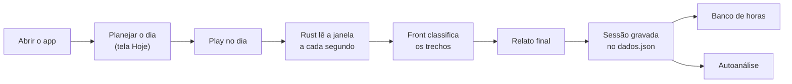
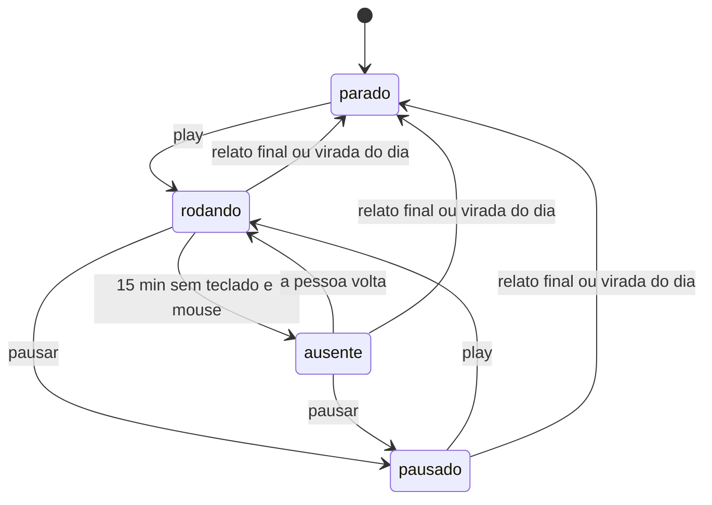
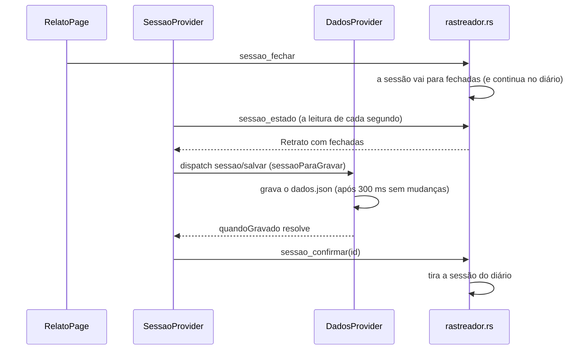

# Tutorial: o fluxo principal do Proof of Study

Este tutorial acompanha um dia de uso do app, da abertura até as horas entrarem no banco, e mostra em cada passo o código que faz aquilo acontecer. É para quem vai mexer no código: no fim, você sabe onde mora cada parte do fluxo e como as peças conversam.

O "fluxo principal" aqui é o dia com play: registro das janelas, classificação, relato final e banco de horas. Rotina, metas, IA e voz aparecem só onde tocam nesse caminho.

## Antes de começar

```bash
npm install
npm run desktop
```

Os requisitos (Node 20+, Rust e as dependências do sistema) estão no [README](../../README.md#rodar). Deixe o app aberto ao lado deste arquivo para conferir cada passo.

## O dia em uma imagem



## As duas metades do app

O app é feito com Tauri: um processo Rust (`src-tauri/`) e uma tela React (`src/`) dentro de um WebView. A divisão segue uma regra (AD-001 em [STATE.md](../../.specs/STATE.md)): **o Rust faz o que é do sistema, o front faz a lógica**.

| Rust (`src-tauri/src/`) | React (`src/`) |
|---|---|
| Relógio de 1 s, janela ativa, tempo sem uso | Classificação das janelas e resumo do dia |
| Sessão do dia e o diário `sessao-ativa.json` | `dados.json`: matérias, objetivos, sessões, relatos, regras |
| Bandeja, atalho global, notificações | Telas, relatos, banco de horas, autoanálise |
| Chave da IA e chamadas ao Gemini | Prompts da IA e validação das respostas |

As duas metades conversam por comandos do Tauri (`invoke`). Os comandos da sessão estão todos em [rastreio.ts](../../src/features/sessao/api/rastreio.ts) e são registrados no Rust em [lib.rs](../../src-tauri/src/lib.rs), no `generate_handler!`.

No front, [Raiz.tsx](../../src/app/Raiz.tsx) monta três contextos, um dentro do outro:

```tsx
<DadosProvider>       {/* dados.json em memória, com gravação automática */}
  <SessaoProvider>    {/* espelho da sessão do dia, que roda no Rust */}
    <JanelaProvider>  {/* modo janela ou widget */}
      <Avisos />
      <RouterProvider router={router} />
```

A ordem importa: a sessão precisa dos dados (regras e objetivos), e todas as telas precisam da sessão. A sessão fica na raiz, e não numa tela, para o widget, a barra lateral e os avisos funcionarem em qualquer rota.

## Passo 1: o app abre

**No Rust**, o `setup` de [lib.rs](../../src-tauri/src/lib.rs) faz três coisas:

1. Lê o diário `sessao-ativa.json` e recupera a sessão do dia, se houver (`Rastreador::carregar` e `recuperar` em [rastreador.rs](../../src-tauri/src/rastreador.rs)). No mesmo dia lógico, a sessão volta como estava, e o tempo com o app fechado vira uma pausa `desligado`. Em outro dia, ela é fechada e espera o front gravá-la.
2. Cria o ícone da bandeja.
3. Liga o relógio: uma thread que, a cada segundo, chama `rastreador::tick` e `lembretes::tick`.

Fechar a janela não encerra o app. O `on_window_event` só esconde a janela, e a sessão continua rodando na bandeja.

**No front**:

1. O [DadosProvider](../../src/store/context/DadosProvider.tsx) chama `carregarDados` ([armazenamento.ts](../../src/store/repositorio/armazenamento.ts)), que lê o `dados.json` pelo `plugin-store` e converte formatos antigos (`atualizarDados` em [migracao.ts](../../src/store/model/migracao.ts)). Até terminar, a tela mostra "Carregando seus dados…".
2. O [SessaoProvider](../../src/features/sessao/context/SessaoProvider.tsx) passa a ler o estado do Rust a cada segundo e manda a configuração do rastreio (regras, termos e preferências) pelo `sessao_configurar`. Sem essa configuração, o Rust não abre sessão. Por isso o play pela bandeja abre a janela quando o front ainda não rodou.
3. Os objetivos que a Rotina prevê para hoje entram sozinhos (`objetivosDaRotina` em [dia.ts](../../src/features/hoje/utils/dia.ts)).

## Passo 2: planejar o dia (tela Hoje)

A rota `/` é a [HojePage](../../src/features/hoje/HojePage.tsx). De cima para baixo:

| Cartão | O que faz |
|---|---|
| `CartaoOntem` | Se o relato final de ontem ficou pendente e ainda está no prazo, pergunta "Como foi ontem?" |
| `CartaoRelatoInicial` | O plano do dia em texto livre (ou voz), que vira objetivos |
| `CartaoPlay` | O relógio do dia, o play e a pausa, e o caminho para o relato |
| `CartaoObjetivos` | Os objetivos do dia com o tempo que cada um recebeu |

**Os objetivos são a peça central.** Um objetivo (`Objetivo` em [dados.ts](../../src/store/model/dados.ts)) é o que a pessoa quer fazer hoje: uma matéria ou um título livre, de estudo ou de trabalho. Ele não tem botão nem cronômetro. O app liga o tempo a ele sozinho, pelos termos que aparecem no título da janela (Passo 6).

Os objetivos chegam por três caminhos, marcados no campo `origem`:

- `rotina`: os itens de estudo da Rotina para aquele dia da semana (`objetivosDaRotina`).
- `relato`: o plano do dia. Sem IA, `sugerirObjetivos` procura no texto o nome e os termos das matérias. Com a IA ligada, o Gemini monta os objetivos (`montarPedidoDoPlano` e `lerRespostaDoPlano`); se ele falhar, o app volta para a busca de palavras.
- `manual`: digitados no `CartaoObjetivos`.

Excluir um objetivo que veio da Rotina não o apaga: ele fica `pulado`, para não voltar no mesmo dia (`objetivo/excluir` em [dados-reducer.ts](../../src/store/reducer/dados-reducer.ts)).

## Passo 3: play no dia

O botão é o `BotaoPlay` ([ControlesDoDia.tsx](../../src/features/sessao/components/ControlesDoDia.tsx)). O clique segue este caminho:

```text
BotaoPlay → useSessao().play()                          SessaoProvider.tsx
          → configurarRastreio(config) + playDoDia()    rastreio.ts
          → invoke('sessao_play')
          → sessao_play → play(&mut estado, agora)      rastreador.rs
```

`play()` no Rust abre uma `SessaoDia` (com um id `dia-…` e o dia lógico) ou retoma a que estava pausada. Pausar e dar play de novo continuam a mesma sessão, e cada pausa vira um item na lista `pausas`. A sessão só fecha com o relato final ou na virada do dia.

A sessão passa por quatro fases (`Fase`, igual em `rastreador.rs` e `rastreio.ts`):



O mesmo play existe na bandeja e no atalho global. Os dois chamam `Rastreador::alternar` (por `alternar_sessao` em [lib.rs](../../src-tauri/src/lib.rs)) direto no Rust, sem passar pelo front.

## Passo 4: o Rust registra as janelas

A cada segundo, `tick` chama `avancar` ([rastreador.rs](../../src-tauri/src/rastreador.rs)), que faz, nesta ordem:

1. **Virada do dia.** Se o dia lógico mudou (por padrão, às 4h), fecha a sessão.
2. **Registro.** Com a fase `rodando`, `registrar` lê a janela ativa (`janela_ativa` em [janela.rs](../../src-tauri/src/janela.rs): título, programa e se é o próprio app) e soma o segundo a um **trecho**. `acrescentar` junta leituras seguidas da mesma janela num trecho só. Por isso uma hora no VS Code é um trecho, não 3.600.
3. **Ausência.** Sem teclado e mouse por 5 min (`limiteAusenciaMin`), os trechos desde o último uso ficam marcados como `ausente`. Por 15 min (`ausenciaLongaMin`), esse tempo sai dos trechos e vira uma pausa automática (fase `ausente`). Quando a pessoa volta, a captura segue sozinha.
4. **Suspensão.** Mais de 10 s entre duas leituras (`SALTO_MS`) quer dizer que o PC estava suspenso. Esse tempo vira uma pausa `suspensao`.
5. **Avisos.** Depois de 60 s seguidos fora do estudo, o Rust manda a notificação "Fora do estudo". Para isso, ele repete uma versão curta da classificação (`distracao`), porque com o app na bandeja o WebView não roda timers. No horário de trabalho, nada avisa.

Um trecho (`Trecho`) guarda só o que foi lido: início, fim, título, programa e as marcas `ausente`, `semCaptura` e `proprio`. **O Rust não decide se um trecho é estudo**, a não ser para o aviso. Quem decide é o front, na hora de mostrar, com as regras do momento.

**O diário.** `gravar_se_preciso` escreve a sessão em `sessao-ativa.json` a cada 15 s e a cada play ou pausa. `gravar_atomico` grava num `.tmp` e depois renomeia, para um desligamento no meio da escrita não deixar o arquivo pela metade. É esse diário que permite a recuperação do Passo 1.

## Passo 5: a tela acompanha

A cada segundo, o `SessaoProvider` pede o estado com `lerRastreio(desde)` (comando `sessao_estado`). O `desde` é quantos trechos a tela já tem. O Rust devolve só os novos e os que mudaram, a partir do índice `base`, para uma sessão de 8 horas não atravessar a ponte inteira a cada segundo:

```ts
const lido = await lerRastreio(trechosRef.current.length)
const anteriores = id === sessaoId.current ? trechosRef.current.slice(0, lido.base) : []
trechosRef.current = [...anteriores, ...lido.trechos]
```

O `Retrato` que volta também traz a fase, as pausas, a janela ativa agora, o tempo sem uso e as sessões que o Rust já fechou (`fechadas`, usadas no Passo 8).

As telas não usam os trechos crus. Elas usam o hook [useResumoDoDia](../../src/features/sessao/hooks/useResumoDoDia.ts), que junta os trechos das sessões já gravadas do dia com os da sessão aberta e passa tudo por `resumir`.

## Passo 6: de janela a estudo (a classificação)

Esta é a regra de negócio mais importante do app. `classificar`, em [classificacao.ts](../../src/features/sessao/utils/classificacao.ts), recebe um trecho e o contexto do dia (`contextoDoDia` em [dia.ts](../../src/features/hoje/utils/dia.ts): regras, matérias, objetivos e horário de trabalho). Ela devolve o grupo e o tipo do trecho (`estudo`, `trabalho`, `fora` ou `ignorar`), nesta ordem (AD-002):

1. **Casos fixos**: captura pausada (ignorar), ausente do PC (fora) e o próprio Proof of Study (ignorar).
2. **Termos dos objetivos de trabalho** do dia no título: trabalho.
3. **Termos dos objetivos de estudo e das matérias** no título: estudo daquela matéria.
4. **Regras** de Apps e sites, as de título antes das de app; a primeira que casa decide. No horário de trabalho da Rotina, uma regra de estudo vira trabalho.
5. **Sem regra**: fora do estudo.

Um exemplo, com a matéria "Blender" cadastrada e as regras padrão (`regrasPadrao` em [dados.ts](../../src/store/model/dados.ts)):

| Janela (título · programa) | Quem decide | Resultado |
|---|---|---|
| `Modelando uma cadeira no Blender - YouTube - Google Chrome` · `chrome` | Passo 3: o termo da matéria | Estudo de Blender |
| `Vídeo engraçado - YouTube - Google Chrome` · `chrome` | Passo 4: a regra de título "YouTube" | Fora do estudo |
| `dia.ts - Proof-of-Study - Visual Studio Code` · `code` | Passo 4: a regra de app "VS Code" | Estudo, sem matéria |
| `Caixa de entrada - Gmail - Google Chrome` · `chrome` | Passo 5: nenhuma regra | Fora do estudo, no grupo "Gmail" |

Os termos casam como palavra inteira e sem acento (`normalizar` e `contemPalavra`): "go" não casa com "google", e "inglês" casa com "Ingles".

Depois, `resumir` ([resumo.ts](../../src/features/sessao/utils/resumo.ts)) junta os trechos por grupo, soma o tempo e calcula `focoMs`, `foraMs`, `trabalhoMs`, as `faixas` da linha do tempo, `porMateria`, `porObjetivo` e `semObjetivoMs`. O estudo sem matéria vai para o objetivo do dia quando ele é o único (`destino`). Com vários objetivos, fica "sem objetivo" até o relato.

> **A mesma lógica em duas linguagens.** A ordem da classificação existe no TS (`classificar`) e, resumida, no Rust (`distracao`, só para o aviso). Se mudar uma, mude a outra. Os testes dos dois lados (`classificacao.test.ts` e os `#[test]` de `rastreador.rs`) cobrem a ordem.

## Passo 7: o relato final

Às 21h30 (`relatoFinalMin`), se houve sessão e ainda não há relato, chega a notificação "Como foi o dia?". Quem agenda é [useAvisoRelatoFinal](../../src/app/hooks/useAvisoRelatoFinal.ts), mas o aviso fica com o Rust (`aviso_agendar`), de novo porque o WebView não roda timers na bandeja.

A rota `/relato?dia=aaaa-mm-dd` é a [RelatoPage](../../src/features/relatos/RelatoPage.tsx). Ela mostra o resumo do dia e deixa a pessoa:

- **Corrigir a atribuição** em `GruposDoDia`: cada grupo de janelas pode ir para outra matéria, para estudo sem matéria, para trabalho, para fora ou ser ignorado. A correção é um `Ajuste` guardado pela chave do grupo e vale **só para aquele dia**; as regras não mudam.
- Escrever (ou falar) **como foi o dia** e marcar o **humor**.
- Com a IA ligada, pedir o insight do dia, que sugere correções para a pessoa aceitar ou recusar.

A página passa as correções em edição para `useResumoDoDia(dia, ajustes)`, então os números mudam enquanto a pessoa mexe, antes de salvar.

O botão **Salvar e encerrar o dia** chama `salvar()`, que faz três coisas:

```ts
// 1. Guarda o relato, só com as correções que mudam algo.
dispatch({ tipo: 'relato/salvar', relato })
// 2. As sessões já gravadas do dia passam a contar com as correções.
for (const s of recalcularDia(comRelato, dia)) dispatch({ tipo: 'sessao/salvar', sessao: s })
// 3. Fecha a sessão aberta no Rust.
if (sessao?.dia === dia) await fecharDia()
```

## Passo 8: a sessão chega ao `dados.json`

Fechar a sessão no Rust não grava nada no `dados.json`. Quem grava é o front, e o caminho é um aperto de mão, para nenhuma sessão se perder se o app fechar no meio:



`sessaoParaGravar` ([dia.ts](../../src/features/hoje/utils/dia.ts)) transforma a `SessaoDoRust` numa `Sessao` com os totais já calculados (`totaisDaSessao`): estudo, fora, trabalho e estudo por matéria. Os totais ficam guardados para o banco de horas não mudar quando, semanas depois, alguém editar uma regra.

O mesmo caminho vale para a sessão que o Rust fecha sozinho na virada do dia e para a que ele recupera de um dia anterior ao abrir.

**Como os dados são gravados.** O reducer ([dados-reducer.ts](../../src/store/reducer/dados-reducer.ts)) é a única forma de mudar os dados. O `DadosProvider` observa o estado e, depois de 300 ms sem mudanças, grava o arquivo inteiro numa fila: uma gravação por vez, sempre com o estado mais recente. `quandoGravado(condicao)` devolve uma promessa que resolve quando o que está no disco já atende à condição.

## Passo 9: o banco de horas

O estudo só **entra no banco** depois de validado. A regra está em [validacao.ts](../../src/features/banco/utils/validacao.ts):

- `diaValidado`: o dia tem relato final **com texto**, feito até o fim do dia lógico seguinte (`prazoDoRelato`).
- `sessaoValidada`: o dia foi validado **ou** a sessão tem anotação própria (texto ou imagem, na tela Banco de horas).
- `focoNoBanco`: o estudo da matéria na sessão, se ela foi validada; senão, zero.

`saldoDaMateria` ([banco.ts](../../src/features/banco/utils/banco.ts)) soma isso na semana e compara com a meta: o que entrou (`noBancoMs`) e o que espera validação (`pendenteMs`). É o que a tela Banco de horas e a barra lateral mostram.

Por isso existe o `CartaoOntem`: se o relato de ontem ficou para trás, o tempo ainda pode entrar no banco até o fim de hoje.

## Passo 10: a autoanálise

A [AutoanalisePage](../../src/features/autoanalise/AutoanalisePage.tsx) lê as mesmas sessões e relatos, de 4 ou 12 semanas, e passa tudo por `autoanalise(dados, dias)` ([insights.ts](../../src/features/autoanalise/utils/insights.ts)): o mapa de foco por hora, as distrações, os blocos de foco, o tempo até a primeira distração, as pausas, o planejado × feito e o humor. Tudo é descritivo e calculado sem IA. O insight da semana com o Gemini é opcional.

## Um conceito que atravessa tudo: o dia lógico

O dia do app não vira à meia-noite, e sim às 4h (`inicioDoDiaMin`). Estudar até 1h da manhã conta no dia anterior. A conta é `diaLogico` ([datas.ts](../../src/shared/lib/datas.ts)) no front e `dia_logico` no Rust. Ela decide a que dia uma sessão pertence, quando a sessão fecha sozinha e até quando o relato final vale.

## Onde mexer

| Para mudar… | Comece por |
|---|---|
| Como uma janela vira estudo, trabalho ou fora | `classificar` em [classificacao.ts](../../src/features/sessao/utils/classificacao.ts) e `distracao` em [rastreador.rs](../../src-tauri/src/rastreador.rs) |
| O que conta nos totais do dia | `resumir` em [resumo.ts](../../src/features/sessao/utils/resumo.ts) |
| O que é lido do sistema | [janela.rs](../../src-tauri/src/janela.rs) |
| Pausas automáticas, virada do dia e diário | `avancar`, `recuperar` e `gravar_se_preciso` em [rastreador.rs](../../src-tauri/src/rastreador.rs) |
| Quando o estudo entra no banco | [validacao.ts](../../src/features/banco/utils/validacao.ts) |
| Os objetivos que entram sozinhos | `objetivosDaRotina` e `sugerirObjetivos` em [dia.ts](../../src/features/hoje/utils/dia.ts) |
| O formato salvo | `VERSAO_DADOS` em [dados.ts](../../src/store/model/dados.ts) e a conversão em [migracao.ts](../../src/store/model/migracao.ts) |
| Um comando novo entre o front e o Rust | [rastreio.ts](../../src/features/sessao/api/rastreio.ts), o `#[tauri::command]` no Rust e o `generate_handler!` em [lib.rs](../../src-tauri/src/lib.rs) |

## Teste você mesmo

Com o app aberto (`npm run desktop`):

1. Em **Banco de horas**, clique em **+ Nova matéria** (ou **+ Matéria**, se já houver alguma) e cadastre "Blender".
2. Em **Hoje**, escreva no plano "estudar blender" e salve. O objetivo Blender aparece nos objetivos do dia.
3. Clique em **Play no dia** e abra no navegador um vídeo com "Blender" no título. Em **Sessão**, o grupo aparece como estudo de Blender. Abra outro vídeo qualquer do YouTube: ele vai para fora do estudo.
4. Abra o **Relato**, mude o grupo do segundo vídeo para Blender e veja os números mudarem. Escreva um texto e clique em **Salvar e encerrar o dia**. Em **Banco de horas**, o tempo aparece validado.

Salvar o relato fecha a sessão do dia. Um novo play no mesmo dia abre outra sessão, que entra no mesmo dia.

Os testes que cobrem esse caminho:

```bash
npx vitest run src/features/sessao/utils/classificacao.test.ts src/features/sessao/utils/resumo.test.ts
```

```bash
cargo test --manifest-path src-tauri/Cargo.toml rastreador
```
